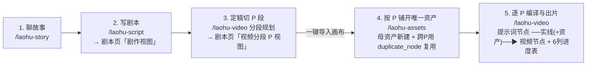

# 老胡画梦枋「剧本创作 × 画布制片」界面审美、分段协同与 Agent 接入深度优化方案（`laohu-analysis` 完整施工规格书）

> **文档定位与受众**：本文是面向严格遵规的实施 AI / 工程师的**端到端产品与工程改造规格书**，全面覆盖老胡画梦枋（源码仓：`老胡无限画布`）的**核心创作心智流程、剧本页 UI 排版与审美重构、画布页按 P 制片布局与视觉规范、跨场分段（P）数据模型演进、以及 `script` / `canvas` 两份 `Agent 接入文档（connection.md）` 的完整改写文本**。  
> **执行边界声明**：本文仅作为深度分析与施工规格文档，**未修改老胡画梦枋任何代码/项目数据，也未修改仓库内任何既有 Skill/Reference 原件**。实施前请先核读 `老胡无限画布/docs/UI设计与美学规范.md` 与对应后端单元测试。

---

## 第一部分：创作者核心理念与 5 步全链路心智地图（实施 AI 必读总纲）

任何页面布局、按钮取舍、数据结构和接入文案，都必须无条件服从以下核心产品定位——**绝不把“创作显示端”做成冰冷的工程师表单，绝不把“写戏的场次”与“拍视频的分段（P）”混为一谈**：

### 1. 两大生态的绝对分工
- **老胡造梦技能（`laohu-*`）= 生产大脑**：负责思考、创意、专业法度与文本/提示词生产——`laohu-story` 构思、`laohu-script` 写剧本、`laohu-video` 做视频分段（P）与视频提示词编译、`laohu-assets` 做全剧视觉与声线资产统筹；
- **老胡画梦枋（软件）= 显示端口、项目库与制作执行台**：
  - **剧本模块（`script`）**：专门负责**优雅阅读、修改、保存剧本正文**，以及在剧本定稿后**清晰展示与审核视频分段（P）方案**，最后一键推送给画布；
  - **画布模块（`canvas`）**：专门负责**按 P 分段纵向铺排制作流水线**——全局唯一资产复用、提示词文本节点审阅、视频节点实线连线与 `@` 引用绑定、进度表追踪与模型出片。

### 2. 创作者从 0 到成片的 5 步自然流程（彻底厘清“何时分段、谁来分段、放在哪儿”）

| 阶段 | 发生位置 | 调用哪个 Skill | 创作者做什么 / 看到什么 | 绝对边界 |
|---|---|---|---|---|
| **第 1 步：聊灵感** | 对话区 | `laohu-story` | 把零散点子聊成完整的故事构想与角色性格 | 不写格式、不分段 |
| **第 2 步：写剧本并审稿** | 对话区 → **画梦枋「剧本页」剧作视图** | `laohu-script` | AI 写入完整剧本（`集 → 场`）；用户在剧本页的**「剧作阅读视图」**里像看电影剧本一样舒舒服服通读、改词 | **写戏阶段绝对不分段！** 页面不显示无意义的“第 1 段” |
| **第 3 步：定稿切视频段（P）** | 对话区 → **画梦枋「剧本页」视频分段视图** | **`laohu-video`**（`laohu-video-planning` + 唯一逐字估时算法） | 剧本满意后、进画布前，用户说“按每段最长 30 秒分段”；Agent 调 `laohu-video` 算清自然估时与保守上界 `≤ U` 写回剧本页。用户在**「视频分段 (P) 视图」**扫一眼每段秒数红绿灯和设计说明，满意即点**「导入画布」** | **分段规则与算法真源唯一在 `laohu-video`**；支持**多短场合一 P**（如 S01+S02→P01）与**长场拆多 P**（如 S09→P06/07/08），不改原文一字 |
| **第 4 步：进画布备齐唯一资产** | **画梦枋「画布页」** + 对话区 | `laohu-assets` | 画布**彻底忘掉场次，全画布按 `P01..Pn` 纵向排布**。`laohu-assets` 把全剧资产分为三类：公共母资产（只在顶部或首次出现段新建一次，后续 P 段**强制用 `duplicate_node` 挂载同源复用副本**，绝不重复生图）、分段专属资产、状态变体资产（基于母图分叉）；全部用 `story` 虚线连向对应 P 段登记进进度表 | 全局同一素材只生成一次；改母图全片同步，改状态变体不污染母图 |
| **第 5 步：逐 P 写提示词 → 连线出片** | **画梦枋「画布页」** + 对话区 | `laohu-video` | 资产就绪后，调 `laohu-video` 为每个 P 编译中文三段式提示词，填入该段虚线连接的**「视频提示词节点」**审阅；右侧创建**「视频生成节点」**，将提示词与本段出镜资产**实线连入**并精确绑定 `@` 引用符号，由底部 **6 列创作进度表** 追踪逐段出片 | 虚线管归属，实线管输入；未获明确授权不自动调用收费模型 |



---

## 第二部分：实地代码现状审计与已有基建保护清单

经对运行中的 `http://127.0.0.1:3000` 服务及源码仓 `老胡无限画布` 只读核查，以下 **5 项高价值底层基建已存在且运转稳定，改造时必须 100% 复用保护，严禁另起炉灶**：

1. **原子剧本导入桥**（`studio_script_import.py`、`canvas_core/headless_canvas.py` 中的 `import_script_segments`）：已支持将剧本快照原子导入普通画布，自动建完整剧本节点、分段文本素材节点、`story` 虚线、`sourceRef` 指纹溯源与创作进度登记；
2. **底部可收起创作进度表**（`static/agent-guide.md` L265–301）：已支持双条纹手柄切换固定/自动收起、点击单元格平滑定位画布节点及 `production_status` 实时查询；
3. **全局唯一素材与同源共用副本**（`static/agent-guide.md` L211–220）：`duplicate_node` 已原生实现 `creationId` / `creationOwnerNodeId` 共享机制——母节点重抽卡全画布同步、单独修改某副本提示词自动分叉为独立变体；
4. **虚实双线机制**（`static/agent-guide.md` L209、L269–271）：`relation:"story"` 虚线专管归属（不进模型输入），普通 `connect` 实线专管模型真实输入，资产分组连视频自动展开；
5. **精确 `@` 引用语法与四套画室主题系统**（`static/agent-guide.md` L127、`docs/UI设计与美学规范.md`、`static/css/studio-theme-palettes.css`）：已具备 `@{text:来源节点ID}` 及「灯下书卷 / 潮汐海图 / 赤焰球场 / 豌豆庭院」四主题 + 浅深双外观语义色体系。

### 实地确认的 6 项核心断点（本方案逐一精准根治）
1. **剧本页套了小说页的壳**（`static/script.html` 共用 `studio-manuscripts.js`）：残留 `smNovelTabs`、`章纲`、`故事阶段版本`；每场默认在左侧树里强挂冗余 `第 1 段` 子节点；缺「复制 Agent 接入」「视图切换」「导入画布」顶部入口；正文无影视剧本排印样式；无「分段设计说明」展示区；
2. **数据模型无法原生“跨场合 P”**（`studio_manuscripts.py` 强制 `Episode → Scene → Segment` 绑定单场）：短场（如 7–10 秒）被迫碎切，长场拆分与短场合并无法在统一 P 轨道表达；
3. **`script` 模块 `connection.md` 技能编排失明**（`studio_connection.py` L378–386）：只讲底层 CRUD API，未告知新对话 Agent“写戏调 `laohu-script`、分段调 `laohu-video`（核准 `U` 与逐字估时，禁止拍脑袋插 `---`）”；
4. **`canvas` 模块 `connection.md` 制片流失明**（`studio_connection.py` L335–345）：未将按 P 铺排、三类资产（公共复用 `duplicate_node` / 专属 / 变体）、提示词节点→视频节点实线连接与 `@` 绑定写成开箱即用 SOP；
5. **画布进度表缺少“视频提示词”中间审阅列 & 缺少标准空间坐标约定**：原 5 列进度表跳过提示词节点，且未规定“顶部母资产带 + 纵向按 P 四列泳道”防蜘蛛网布局；
6. **剧本页缺少可视化「导入画布」弹窗**：后端已有 `import_script_segments`，但前端无触发按钮。

---

## 第三部分：画梦枋「剧本创作页（`script.html`）」UI 排版、交互与视觉审美重构规格

### 1. 视觉审美基调（严格遵循 `docs/UI设计与美学规范.md`）

实施 AI 必须严格承接画梦枋既有画室美学基因，**禁止自创违和配色或廉价科技感发光**：
- **主题与语义令牌全复用**：全部样式基于 `static/css/studio-manuscripts.css` 的 `--sm-*` 与 `--studio-*` 变量，自动完美适配「灯下书卷（默认）」「潮汐海图」「赤焰球场」「豌豆庭院」四大主题与浅色/深色双外观；普通文字对比度 `≥ 4.5:1`，大号标题 `≥ 3:1`；
- **三大设计刻度严守**：`DESIGN_VARIANCE: 5`（页面结构稳定网格）、`MOTION_INTENSITY: 3`（仅克制的悬停、切视图、弹层微动效 `120–160ms ease`）、`VISUAL_DENSITY: 6`（信息密度饱满但每块必有 4px 倍数网格呼吸留白）；
- **三档圆角与点击热区**：控件 `8–10px`、面板/卡片 `12–14px`、弹窗 `14–18px`；图标按钮固定 `36×36px`；间距严格使用 `4px` 倍数（`4 / 8 / 12 / 16 / 20 / 24px`）；
- **书卷纸面阅读感**：正文区域承托于微暖/微深纸面（`--sm-surface` 居中浮于 `--sm-page` 之上，轻 1px `--sm-line` 边框与克制纸面阴影），让创作者打开剧本页时感受到**专业影视剧作稿本的沉静、清晰与呼吸感**，而非杂乱的后台管理系统。

---

### 2. 顶部工具栏与双视图整体布局（精确控件清单）

```text
┌────────────────────────────────────────────────────────────────────────────────────────┐
│ [☰]  剧本创作 / 小鲸鱼救爷爷  [rev.2]                                                    │
│      ┌────────────────────────────┐                                                    │
│      │ ● 剧作阅读  │  ○ 视频分段(P) │    [📋 Agent接入 ▾]  [🎬 导入画布]  [↻] [中] [🌗]  │
│      └────────────────────────────┘                                                    │
├──────────────────────┬─────────────────────────────────────────────────────────────────┤
│ 左侧目录 (272px 宽)   │ 主阅读与工作区 (最大阅读宽 760px 居中，四周留呼吸白)              │
│                      │                                                                 │
│ 【剧作阅读模式】      │  [面包屑: 小鲸鱼救爷爷 / S03 外·羊村小院·除夕清晨]                 │
│  [🔍 搜索场次/内容]   │  [动作条: ✎编辑正文 | ❐复制 | ✨AI优化 | 🕒历史 | ⬇导出MD]        │
│  ┌────────────────┐  │  ─────────────────────────────────────────────────────────────  │
│  │ ▾ 第1集 小鲸鱼… │  │  ┃ S03  外·羊村爷爷小院·除夕清晨             463字 · 约25s      │
│  │   S01 群山夜空 │  │  ─────────────────────────────────────────────────────────────  │
│  │   S02 爷爷小院 │  │  [转场] 时间溶切与声桥切入                                       │
│  │ ▶ S03 除夕清晨 │  │                                                                 │
│  │   S04 摇人快切 │  │  ▏ △ 屋檐下的红灯笼光渐褪为清晨淡白雪光。摇椅上的小鲸鱼仍在熟睡。  │
│  │   ... (无碎段!) │  │  ▏    画外先传来掀翻竹筐与翻动木箱的急促叮当声。                  │
│  │ [+ 新增场次]   │  │                                                                 │
│  └────────────────┘  │     羊爷爷  (O.S.；焦急、边翻边念叨)                             │
│  [底部: 集纲 / 统计]  │     哎？我那挂大鞭炮呢？明明放屋檐下了，怎么找不着了……            │
│                      │                                                                 │
├──────────────────────┼─────────────────────────────────────────────────────────────────┤
│ 【视频分段(P)模式】   │  ┌───────────────────────────────────────────────────────────┐ │
│  上限 U: [30秒 ▾]    │  │ P01  雪夜压境与藏炮入梦    [来源: S01+S02]  [● 22~28s / 30s] │ │
│  共 8 段 · 约3分12秒  │  ├───────────────────────────────────────────────────────────┤ │
│  ┌────────────────┐  │  │ ▾ 分段设计说明（可折叠轻底抽屉 · 不混入原文）                │ │
│  │▶ P01 雪夜藏炮   │  │  │   · 本段任务：史诗开场转除夕温馨藏炮                        │ │
│  │  S01+S02 🟢28s │  │  │   · 初镜概要：镜01雪峰俯冲(8s) + 镜02院子藏炮睡着(18s)       │ │
│  │  P02 除夕被抓   │  │  │   · 段尾接续：小鲸鱼廊下睡熟，鞭炮已入百宝肚兜              │ │
│  │  S03     🟢25s │  │  ├───────────────────────────────────────────────────────────┤ │
│  │  P03 摇人出发   │  │  │ [逐字保真剧本正文 · 只读锁显 / 点击编辑跳回源场]            │ │
│  │  S04+S05 🟢27s │  │  │   ┃ S01 外·风雪群山与羊村夜空·除夕前夜                      │ │
│  │  P06 城堡惨败   │  │  │   ▏ △ 暴雪翻涌，黑红雷云压过连绵雪峰……                     │ │
│  │  S09-1   🔴33s!│  │  │   ┃ S02 外·羊村爷爷小院·除夕前夜                            │ │
│  └────────────────┘  │  │   ▏ △ 院门贴着大红春联，细雪轻飘……                          │ │
│  [底部: 🎬全部导画布] │  └───────────────────────────────────────────────────────────┘ │
└──────────────────────┴─────────────────────────────────────────────────────────────────┘
```

#### 顶部栏与快捷按钮精确规格（移除噪音，补全刚需）
1. **隐藏小说专属残留**：在 `body[data-manuscript-module="script"]` 下彻底移除/隐藏 `smNovelTabs`（设定库）及 `smVersionTools` 里的“故事阶段版本”下拉框（剧本历史统一由「文字修订」抽屉承接，清爽不杂乱）；
2. **新增中央「双视图切换分段器（Segmented Control）」**（`id="smScriptViewSwitch"`）：
   - 样式：槽底 `--sm-muted-surface`，圆角 `10px`，内边距 `3px`；选中项使用 `--sm-raised` 实底 + 轻微阴影 + `--studio-accent-text` 粗体，图标为 `book-open`（剧作阅读）与 `scissors` / `clapperboard`（视频分段 P）；
   - 切换状态记入 `sessionStorage`，刷新保持当前视图；
3. **新增「📋 Agent 接入」主按钮与下拉菜单**（`id="smAgentConnectBtn"`）：
   - 放在剧本页右上主操作区，点击展开简洁浮层（2 个一键复制选项，彻底解决用户“每次要退回列表页找接入按钮、还得手敲要求分段”的痛点）：
     - **选项 1：复制常规接入指令**（接入当前剧本项目读写）；
     - **选项 2：复制「视频分段 (P)」专用指令**（内置用户当前选定的上限 `U`，例如复制出：*“请接入老胡画梦枋剧本项目 `小鲸鱼救爷爷`（ID...），调用 `laohu-video` 分段规划能力，按单段上限 30 秒做逐字保真视频分段，给出分段设计说明与估时并写回本项目。”*）；
4. **新增「🎬 导入画布」主强调按钮**（`id="smImportCanvasBtn"`）：
   - 采用主题主操作色（`brand.primary` / `action.primary`），一眼成为剧本页收口主出口（同一区域仅此一个主色按钮，符合规范 3.1 节）；
   - 点击弹出**「导入分段到画布」模态框**（宽 `460px`，圆角 `16px`）：
     1. **目标画布选择**：下拉选择已有普通画布（调用 `GET /api/studio/projects?module=canvas`），或勾选「新建同名画布」（自动创建后导入）；
     2. **导入范围**：默认「全部已分段 P（共 N 段）」，支持按单集或勾选指定 P 段；
     3. **导入模式**：单选「追加导入 (`append`，自动跳过未变动的已导入段)」或「保留旧节点并追加新快照 (`new_snapshot`)」；
     4. **空段预检提示**：若存在空段，用 `--sm-danger-soft` 温和提示具体哪一段为空，禁用提交避免 409 报错；
     5. **成功反馈**：显示“已导入 N 段剧本至《画布名》”，直接提供「立即打开该画布」按钮！

---

### 3. 「剧作阅读视图」专属排印美学规范（让剧本读起来像真正的大片剧作稿！）

在 `studio-manuscripts.js` 的 `renderScriptBlocks` 中，保持底层 Markdown 源文 100% 不变，仅在**阅读态 DOM 渲染层**解析并赋予影视剧本级排印层次（纯 CSS 实现，兼容所有四套主题与深浅模式）：

| 剧本语法特征 | 解析规则（纯前端阅读态渲染） | 视觉审美与精确 CSS 规格 |
|---|---|---|
| **阅读容器** | `.sm-script-sheet` | 最大宽度 `740px` 居中，背景 `--sm-surface`，内边距 `32px 40px`（窄屏 `20px 16px`），圆角 `14px`，1px `--sm-line` 边框；正文字号 `15px`，行高 `1.85` |
| **场头** (`## S01 ...`) | 场次标题块 `.sm-scene-banner` | 顶部留白 `24px`，底色 `--sm-muted-surface`，左侧 `3px solid var(--sm-accent)` 强调竖条，圆角 `0 8px 8px 0`，内边距 `10px 14px`；字号 `16px` 字重 `720`；右侧弱化等宽展示本场字数与参考估时（如 `463字 · 约25s`） |
| **转场/快切提示** (`△ （...切/转场...）`) | `△` 后紧跟中文括号含“转场/切/溶切/声桥/匹配/快切”的段落 `.sm-script-transition` | 独立行展示：左侧显示柔色胶囊标签（如 `转场` / `快切1`），背景 `--sm-accent-soft`，文字 `--studio-accent-text` `11px 700`；正文用 `--sm-secondary` `13.5px`，上下留白 `10px` |
| **动作与画面块** (`△ ...`) | 普通 `△` 起始段 `.sm-script-action` | 左侧 `2px solid var(--sm-line-strong)` 轻竖线 + 左内边距 `12px`，`△` 符号染淡主题色（`--sm-accent`，透明度 `0.7`）作为稳定视觉锚点，正文 `--sm-text`，与前后段距 `12px`，视觉节奏极度清晰 |
| **角色台词行** (`角色名（括注）：台词`) | 匹配 `^([^：\n（(]{1,16})(?:[（(]([^）)\n]+)[）)])?[：:](.+)$` `.sm-script-dialogue` | 块级左右/上下微缩进（左距 `16px`），形成天然剧本对白剧场感：<br>· **角色名**：`14px`、字重 `720`、`--sm-text`；<br>· **表演/声源括注**（如有）：紧跟角色名右侧，字号 `12.5px`、颜色 `--sm-secondary`、圆角 `6px` 淡底 `--sm-muted-surface` 内边距 `1px 6px`（让配音/视频导演一眼扫到表演提示，又不割裂读台词！）；<br>· **台词正文**：`15px`、行高 `1.8`、`--sm-text`，视觉权重最高 |
| **左侧目录隐藏冗余单段** | 当某 `scene` 仅包含 1 个默认整场段且未标记分段元数据 | **剧作视图左侧树直接折叠/隐藏该 `第 1 段` 叶子节点**，点击场次即直接阅读/编辑该场完整正文！目录瞬间减半，清爽倍增 |

---

### 4. 「视频分段（P）视图」卡片与时长红绿灯规范

切到「视频分段（P）视图」时，页面立刻进入**制片审段模式**：
- **左侧目录顶部**：显示用户当前目标上限 `U`（可下拉或输入 `15s / 20s / 30s / 自定义`，仅作标尺参考不改正文）及汇总条（`共 8 段 · 自然总估 3分05秒 · 0 段超限`）；
- **时长健康度三态徽章（严格图标 + 文字双编码，绝不单靠颜色！）**：
  - **🟢 健康区间**（`≥ 10s` 且 `保守上界 ≤ U`）：`status.success` 淡底 + `✓ 22~28s`；
  - **🟡 偏短提醒**（`< 10s`，易造成视频生成过碎）：`status.warning` 淡底 + `⚠ 7s 偏短`；
  - **🔴 超限警示**（`保守上界 > U`，强行生视频会赶戏或崩坏）：`status.danger` 淡底 + `✕ 33s 超限`；
  - **🟠 原文变更待复核**（源场正文修改后哈希变化）：`status.warning` 淡底 + `↻ 原文已改·待复核`；
- **右侧每张 P 段卡片结构**：
  1. **卡头**：粗体 `P01｜雪夜压境与藏炮入梦` + 来源场次胶囊（`S01 + S02`，点击可一键跳回剧作视图定位源场）+ 时长健康徽章 + 单段操作（`[复制本段]` / `[导入此段到画布]`）；
  2. **可折叠「分段设计说明」抽屉**（默认展开首段或按用户记忆）：背景 `--sm-muted-surface`，圆角 `10px`，清爽呈现 `laohu-video` 写入的「本段任务」「初镜概要（镜01 约8s + 镜02 约18s）」「段尾状态与下一 P 接续」；
  3. **逐字保真正文区**：沿用上述剧本排印样式呈现本 P 覆盖的完整原文（跨场时自动保留原 `## S01`、`## S02` 场头锚标），确保与源稿逐字一致。

---

## 第四部分：画梦枋「画布页（`smart-canvas.html`）」按 P 制片空间排版、视觉审美与 6 列进度表规格

### 1. 画布标准空间美学：顶部「全剧母资产带」 + 纵向「按 P 四列流水线泳道」

画布背景保持安静，节点布局严格按 **4px 网格倍数** 排布，彻底消灭多段制作时的蜘蛛网乱线：

```text
═══════════════════════════════════════════════════════════════════════════════════════════════
 Y = 60   【顶部区域：全剧公共母资产带 (Master Assets Strip)】  （可选浅虚线容器包裹）
          X=80 [完整剧本]   X=440 [Style Lock画风卡]   X=800 [母:小鲸鱼]   X=1120 [母:大小姐] ...
═══════════════════════════════════════════════════════════════════════════════════════════════

 Y = 420  ┌─ 第1列 (X=80) ──┐   虚线    ┌─ 第2列 (X=480) ────────────┐   虚线    ┌─ 第3列 (X=1220) ─┐   实线    ┌─ 第4列 (X=1640) ─┐
  (P01)   │ P01_雪夜藏炮     │╌story╌▶│ ╭─ P01_资产分组 ───────────╮ │╌story╌▶│ P01_视频提示词    │─────────▶│ P01_视频          │
          │ (22~28s / 30s)  │          │ │ 🔗小鲸鱼_基础 (复用)      │ │          │ (kind:material)  │          │ (kind:video)      │
          │                 │          │ │ ★羊爷爷_基础 (新建)       │ │──实线(资产输入)─────────────────────▶│ @文本1 + @图片1/2 │
          │                 │          │ │ ★镇村鞭炮    (新建)       │ │          │ 中文三段式正文    │          │ 状态: 待生成/成片  │
          └─────────────────┘          │ ╰──────────────────────────╯ │          └──────────────────┘          └───────────────────┘
                                       └──────────────────────────────┘
 Y = 840  ┌─ 第1列 (X=80) ──┐   虚线    ┌─ 第2列 (X=480) ────────────┐   虚线    ┌─ 第3列 (X=1220) ─┐   实线    ┌─ 第4列 (X=1640) ─┐
  (P02)   │ P02_除夕被抓     │╌story╌▶│ ╭─ P02_资产分组 ───────────╮ │╌story╌▶│ P02_视频提示词    │─────────▶│ P02_视频          │
          │ (24~29s / 30s)  │          │ │ 🔗小鲸鱼_基础 (duplicate) │ │          │ (kind:material)  │          │ (kind:video)      │
          │                 │          │ │ 🔗羊爷爷_基础 (duplicate) │ │──实线(资产输入)─────────────────────▶│ @文本1 + @图片1/2/3│
          │                 │          │ │ ★年兽_威武态 (新建)       │ │          │ 中文三段式正文    │          │                   │
          └─────────────────┘          │ ╰──────────────────────────╯ │          └──────────────────┘          └───────────────────┘
                                       └──────────────────────────────┘
```

#### 空间坐标与节奏规范（供 `import_script_segments` 和画布 Agent 默认遵循）
- **四列固定 X 轨道**：第 1 列分段剧本 `X = 80`（宽 `320px`）→ 第 2 列本段资产分组 `X = 480`（可容纳 2–3 张并排资产卡，间距 `20px`）→ 第 3 列视频提示词文本节点 `X = 1220`（宽 `340px`）→ 第 4 列视频生成节点 `X = 1640`（宽 `360px`）；
- **纵向行高**：每条 P 段占独立水平泳道，默认行距 `ΔY = 420px`（若本段资产超过 3 张自动换行撑高时，下方泳道按实际最大高度 + `64px` 留白顺延，严禁节点重叠）。

---

### 2. 三类资产节点的视觉角标与连线审美（克制、一眼分清，绝不花哨！）

严格遵守 `docs/UI设计与美学规范.md`（不滥用发光、颜色必须配图标+文字双编码）：

| 资产身份 | 底层数据判定依据 | 节点头部右上角克制胶囊徽章 | 视觉交互细节 |
|---|---|---|---|
| **🔗 复用（同源共用副本）** | `creationOwnerNodeId != id` 且共享 `creationId` | 背景 `--sm-accent-soft`，文字 `--studio-accent-text`，`11px 650`，显示 **`🔗 复用`** | 悬停显示提示：`同源于「母节点名」，母节点重抽时自动同步，不重复计费`；点击徽章可一键平滑定位到母资产节点 |
| **⚡ 变体（状态变体分支）** | 经 `duplicate_node` 后独立修改提示词分叉出新 `creationId`，且连有基础母图作参考 | 背景 `status.info` 淡底，显示 **`⚡ 变体`** | 悬停显示继承自哪个基础母资产（如 `基于「大小姐_基础」的状态变体`） |
| **★ 专属（本段新建独立资产）** | 原生新建独立资产（非共享副本） | 仅在归属 `Pxx_资产` 组内时轻展示或省略冗余徽章，保持画面安静 | — |

#### 虚实双线视觉区分规范
- **组织归属虚线（`relation:"story"`）**：平时以 `1.5px` 低对比淡灰虚线（`stroke-dasharray: 5 5`，透明度 `0.45`）柔和退居背景，绝不干扰画布阅读；**当用户鼠标悬停或选中某一段 `Pxx` 剧本节点时，该整排的 `story` 虚线与所属资产/提示词/视频节点温和提亮**，瞬间看清一整段的所有家当！
- **模型真实输入实线（普通 `connect`）**：`2px` 清晰实线（主题色或语义色），明确表达“资产 → 视频节点”和“提示词文本节点 → 视频节点”的真实数据流。

---

### 3. 底部「创作进度表」从 5 列升级为 6 列（新增“视频提示词”审阅列）

将画布底部可收起导航表从现有 5 列升级为 **6 列**，与老胡“先写提示词审阅、再连进视频节点生成”的真实习惯 100% 对齐：

| 列序 | 列名 | 单元格呈现规范（图标 + 短文字双编码，点击平滑定位节点） |
|---|---|---|
| 1 | **序号 / P** | `P01`（若无 P 编号回退 `1`），旁附估时小标（如 `28s`） |
| 2 | **分段剧本** | 节点标题（如 `雪夜藏炮`）；若源剧本变更叠加 `↻ 待复核` 警示小标 |
| 3 | **图片资产** | 横向紧凑微缩略图队列；已就绪显示真实缩略图（复用副本右下角叠极小 `🔗` 标），未生图显示灰态占位芯片 |
| 4 | **音频 / 音色** | 已关联的音色/配音/音效芯片，未用显示 `—` |
| 5 | **视频提示词（新增！）** | `kind:"material"` 且以 `story` 虚线连向本段、角色为 `production.role="video_prompt"` 的文本节点：<br>· 未创建：`○ 待写`<br>· 已写入正文：`📝 已就绪 (xxx字)`（悬停预览前两行，点击直达节点编辑） |
| 6 | **视频成片** | 未建显示 `○ 待建`；已建未跑显示 `▷ 待生成`；运行中显示微旋转动效；已生成显示首帧缩略图 + 版本数 `v2`；失败显示 `✕ 失败` |

---

## 第五部分：后端数据模型平滑演进与 API 规格

为确保老项目（包括已导入的《小鲸鱼救爷爷》与《主神世界》）**100% 向后兼容零破坏**，后端按两阶段平滑升级：

### 阶段一（P1 · 零破坏元数据扩展）
1. **`studio_manuscripts.py`**：在每个 `Segment` 对象上允许存储可选字段 `video_meta`（新增轻量命令 `update_segment_meta` 或允许 `set_scene_segments` / `create_segment` 携带）：
   ```json
   {
     "part_code": "P01",
     "part_title": "雪夜压境与藏炮入梦",
     "merge_group": "P01",
     "target_cap_sec": 30,
     "estimate_min_sec": 22,
     "estimate_max_sec": 28,
     "upper_bound_sec": 29,
     "design_note": "本段任务：...\n初镜概要：...\n段尾接续：..."
   }
   ```
   - **跨场合并兼容规则**：相邻短场（如 `S01` 与 `S02`）打上相同 `merge_group: "P01"` 时，剧本页「视频分段 P 视图」和 `import_script_segments` 自动按 `merge_group` 顺序拼接原文（保留原场头 `## S01`、`## S02`）并导入为一个 `P01` 分段节点！
2. **`canvas_core/headless_canvas.py`**：`production_status` 新增识别 `production.role == "video_prompt"`（或标题/标记为提示词节点且由分段经 `story` 虚线连向的文本素材节点），返回 `promptNodeIds` 供底部 6 列创作进度表直接渲染。

### 阶段二（P2 · 原生跨场 `production_parts[]` 轨道）
在 `Episode` 对象下新增与 `scenes` 平行的 `production_parts[]` 数组（通过 `source_spans: [{scene_id, start, end, scene_sha256}]` 引用真实正文切片）：
- 原生支持“多场合一 P”与“一场拆多 P”，彻底解除单场绑定；
- 原文只存一份在 `scenes` 中，修改任一场台词导致 `scene_sha256` 变更时，受影响的 `P` 自动置 `status: "needs_recheck"`；
- `import_script_segments` 扩展支持 `scope: {"type": "parts", "ids": [...]}`，直接按 `production_parts` 原子导入画布并按第四部分四列坐标初始化排布。

---

## 第六部分：可直接落盘的两份 `Agent 接入文档（connection.md）` 升级文案

请实施 AI 在 `老胡无限画布/studio_connection.py` 中，**保留原有全部 API 路径、并发保护（`expected_revision` / `expected_canvas_revision`）、409 处理与错误重试规则**，分别在 `script` 和 `canvas` 两段 `connection.md` 模板中置入以下标准作业流指引（并同步更新 `static/agent-guide.md` 与 `tests/test_studio_connection.py`）：

### 1. 追加至 `script` 模块 `connection.md`（紧接“## 接入后的作品操作”首部）

````markdown
### 创作、视频分段（P）与移交画布标准流程

本项目是剧本正文与视频分段（P）的展示与保存端；专业创作与分段规则由老胡造梦技能承担。接入与读取不自动触发创作或模型调用，仅按用户明确要求执行对应阶段：

1. **写剧本与改稿 → 调用 `laohu-script`**：
   - 用户要求创作、扩写、改场或润色台词时，调用 `laohu-script` 完成正文，并按 `expected_revision` 通过 `import_markdown` 或 `update_scene` 写回本项目。创作正文阶段不强行插入视频分段线。
2. **剧本定稿后做视频分段（P）→ 必须调用 `laohu-video` 分段规划能力**：
   - 当用户要求把剧本分段、切 `P` 段以准备进画布做视频时，**必须调用 `laohu-video`（读取其分段交接规范与 `laohu-video-planning` 模块，采用唯一逐字预算估时与并行事件核算算法）**，禁止凭直觉随意插入 `---`。
   - **分段硬纪律**：先核实用户确认的单段时长上限 `U`（如 15 秒或 30 秒，缺失且影响切界时先问用户，绝不硬猜）；按原顺序逐字保真覆盖原文，不删台词、不摘要、不假压时；每段核算自然估时区间与保守上界（`保守上界 ≤ U`），避免切出过短碎片；支持按自然相位于长场内拆多 P 或将相邻短场标记合并为同一 P。
   - **回写与展示**：将分段边界与每段元数据（`P` 编号、标题、来源场次、估时区间、保守上界 `U`、初镜概要与段尾接续说明）写回本项目供用户在「视频分段 (P) 视图」审核。
3. **移交画布制片 → `import_script_segments`**：
   - 分段经用户确认并明确要求进入画布制作后，调用目标普通画布的 `import_script_segments` 将分段快照原子导入画布，自动按 P 生成分段节点与创作进度登记。
````

### 2. 追加至 `canvas` 模块 `connection.md`（紧接“## 接入后的作品操作”首部）

````markdown
### 按分段（P）制片与 Skill 协同标准流程

当本画布用于剧本分段转视频制作时，遵循“全画布按 P 分段纵向排布（不按场次排布）、全局资产唯一复用、虚线管归属、实线管输入”的统一流水线（所有写入必须携带最新 `expected_canvas_revision`；默认先完成布局、提示词与连线供审阅，仅经用户明确授权才调用 `run_node` 计费生成）：

1. **确认分段剧本轨道（第 1 列，按 P01..Pn 纵向排布）**：
   - 先查 `production_status` 与 `GET /api/agent/canvases/{canvas_id}/nodes`。若尚未导入，按用户授权调用 `import_script_segments` 导入已分好的 P 段剧本节点。
2. **全剧资产统筹与全局唯一复用 → 调用 `laohu-assets`（顶部母资产带 + 第 2 列本段资产组）**：
   - 通读全部 P 段后，调用 `laohu-assets` 确立同作画风基线（Style Lock）并把资产分为三类：
     - **全剧共同基础资产**（主角基础形象、高频核心场景/道具）：在顶部母资产带（或首次登场的 P 段）用 `create_node` 新建一次；**后续任何同样用到该资产的 P 段，严禁重新 `create_node` 生成，必须调用 `duplicate_node` 将其复制到该 P 段右侧并排位置**（共享 `creationId`，改母图全片同步，绝不重复生图）；
     - **分段专属资产**：在对应 P 段右侧新建；
     - **状态变体资产**（如战损、换装、特殊形态）：先从基础母资产 `duplicate_node` 到目标 P 段，再把基础母资产作为参考图用普通实线 `connect` 连入该节点并修改状态提示词，使其自然分叉为独立变体而不污染母图。
   - 将本段右侧资产打包进 `Pxx_资产` 分组，并用 `connect(relation:"story")` 虚线从该 P 段剧本连向这些资产（自动登记至底部创作进度表）。
3. **逐 P 提示词编译、视频节点装配与 `@` 引用对齐 → 调用 `laohu-video`（第 3 列 + 第 4 列）**：
   - 调用 `laohu-video` 结合本段剧本与本段已规划/生成的资产，编译完整中文三段式视频提示词：
     - 在本段资产区右侧创建 `kind:"material"` 文本节点（命名 `Pxx_视频提示词`，标记 `production.role:"video_prompt"`），写入提示词并用 `relation:"story"` 虚线连向本段剧本；
     - 在其右侧创建 `kind:"video"` 视频生成节点（命名 `Pxx_视频`），同样用 `relation:"story"` 虚线连向本段剧本（登记入底部进度表）；
     - 用**普通实线 `connect`** 将本段出镜的图片/音频资产（或资产分组）以及 `Pxx_视频提示词` 连入 `Pxx_视频`；
     - 在 `Pxx_视频` 提示词中精确绑定 `@{text:提示词节点ID}`（或直填提示词）并确保正文中的资产引用符号与实际实线连入的媒体一一对应，零悬空引用。
````

---

## 第七部分：面向实施 AI 的分阶段施工单与验收协议

### 1. 分阶段执行顺序（严格按 P0 → P1 → P2 推进，每阶段独立提交测试）

- **阶段 P0（立刻打通新对话 Agent 全链路 · 改动最小、收益立竿见影）**：
  1. 编辑 `老胡无限画布/studio_connection.py`：在 `script` 与 `canvas` 中文/英文 `connection.md` 中写入第六部分两段标准流程；
  2. 编辑 `老胡无限画布/static/agent-guide.md`：同步补充“顶部母资产带 + 纵向按 P 四列泳道”、“三类资产（复用/专属/变体）”、“`video_prompt` 节点与 6 列进度表”约定；
  3. 运行 `pytest tests/test_studio_connection.py` 及相关既有测试确保全绿。
- **阶段 P1（核心界面审美重构 + 6 列进度表 + 元数据兼容）**：
  1. 后端：`studio_manuscripts.py` 为 `Segment` 增加可选 `video_meta` 读写与 `merge_group` 导入合并支持；`headless_canvas.py` 在 `production_status` 中返回 `promptNodeIds`；
  2. 剧本页前端：`static/script.html`、`static/js/studio-manuscripts.js`、`static/css/studio-manuscripts.css` 实现第三部分全部改造——顶部双视图分段器、Agent 接入双口令下拉、一键「导入画布」弹窗、剧作视图隐藏无意义单场“第 1 段”与五大剧本语法排印样式、视频分段 P 视图卡片 + 时长红绿灯 + 折叠分段设计说明；
  3. 画布页前端：`static/smart-canvas.html` 及对应 JS/CSS 实现底部 **6 列创作进度表**、节点右上角 `🔗 复用` / `⚡ 变体` 徽章与选中分段时整排虚线温和提亮；
  4. 同步补齐浏览器与后端测试，并按 `docs/UI设计与美学规范.md` 核查**四大主题 × 浅深双外观 × 桌面/窄屏视口**。
- **阶段 P2（原生跨场 `production_parts[]` 轨道升级）**：
  1. 在 `studio_manuscripts.py` 引入 `Episode.production_parts[]` 与 `source_spans` 切片校验、正文修改自动标 `needs_recheck`；
  2. 升级 `studio_script_import.py` 与 `headless_canvas.py` 支持直接按 `production_parts` 导入画布并按四列泳道自动初始化默认坐标。

### 2. 端到端实测验收样本与四类证据表

落地后以已保存的真实项目 **`小鲸鱼救爷爷`（ID: `ccbaa2f08eae4e1ea1a206cf68c8e9ae`，10 场）** 执行一次全流程验收：
1. **UI 与审美验收**：分别在「灯下书卷（浅/深）」「潮汐海图」「赤焰球场」「豌豆庭院」下打开 `小鲸鱼救爷爷`，确认剧作视图无多余“第 1 段”、场头/`△`/括注/台词层次清晰舒适、顶部按钮单行对齐无换行折行、窄屏无遮挡；
2. **新对话分段验收**：点击顶部「复制视频分段指令」开新对话（指定 `U = 30秒`），验证 Agent 自动调用 `laohu-video` 将 `S01`–`S10` 切为无超限红灯、无过短碎段的健康 `P` 方案并写回，剧本页「视频分段 P 视图」清晰显示每段估时与设计说明；
3. **画布按 P 复用与连线验收**：点「导入画布」进新画布，开新对话让 Agent 铺资产与提示词——验证公共主角基础卡只建一次、后续 P 段全用 `duplicate_node` 显示 `🔗 复用`、战损态显示 `⚡ 变体`、`Pxx_视频提示词` 虚线连分段且实线连入 `Pxx_视频` 并绑定 `@` 引用、底部 6 列进度表全部亮起。

| 证据类别 | 当前状态 | 范围与依据说明 |
|---|---|---|
| `STRUCTURE` | `PASS`（针对本文档本身，已通过 `python3 tools/check_project.py` 终验） | 已实地核读 `老胡无限画布` 的 `UI设计与美学规范.md`、`script.html`、`studio-manuscripts.css`、`studio-manuscripts.js`、`studio_connection.py`、`studio_script_import.py`、`headless_canvas.py` 与 `agent-guide.md`；未改动任何软件代码或 Skill 原件 |
| `ROUTE` | `UNKNOWN`（待 P0 落盘后新对话实测） | 需开全新对话实测 `script` / `canvas` 新版 `connection.md` 对 `laohu-script`、`laohu-video`、`laohu-assets` 的准确触发 |
| `BEHAVIOR` | `UNKNOWN`（待 P1/P2 实施后实测） | 需以《小鲸鱼救爷爷》跑通分段回写、弹窗导画布、母资产 `duplicate_node` 复用与 6 列进度表联动 |
| `QUALITY` | `UNKNOWN`（待真实界面操作与视觉验收） | 最终剧本阅读美感、四主题浅深适配与画布多段制片流畅度须由老胡在真实浏览器中实操裁定 |
